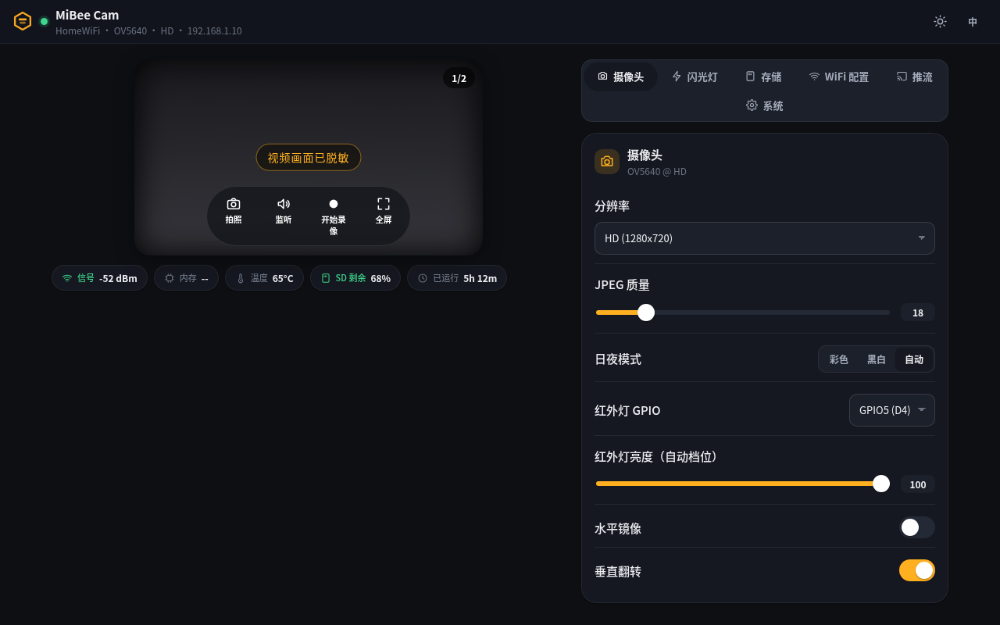
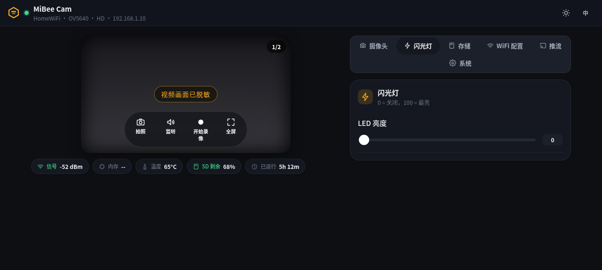
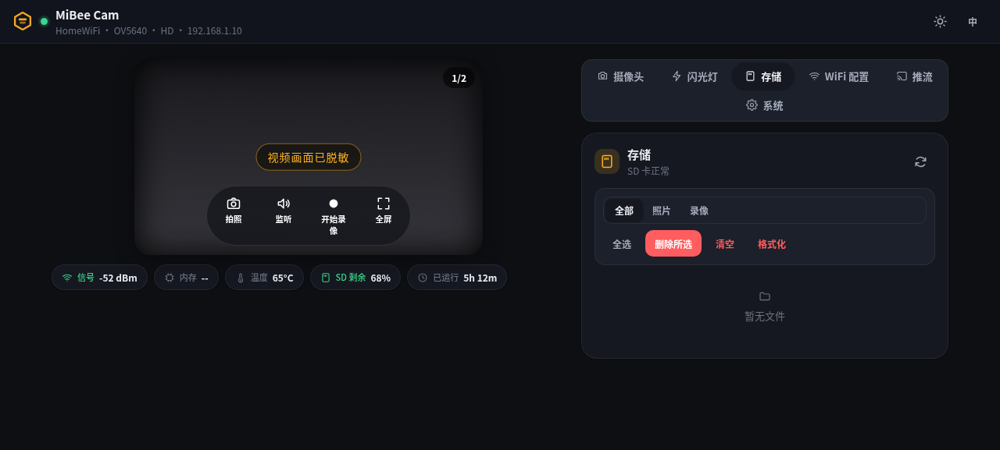
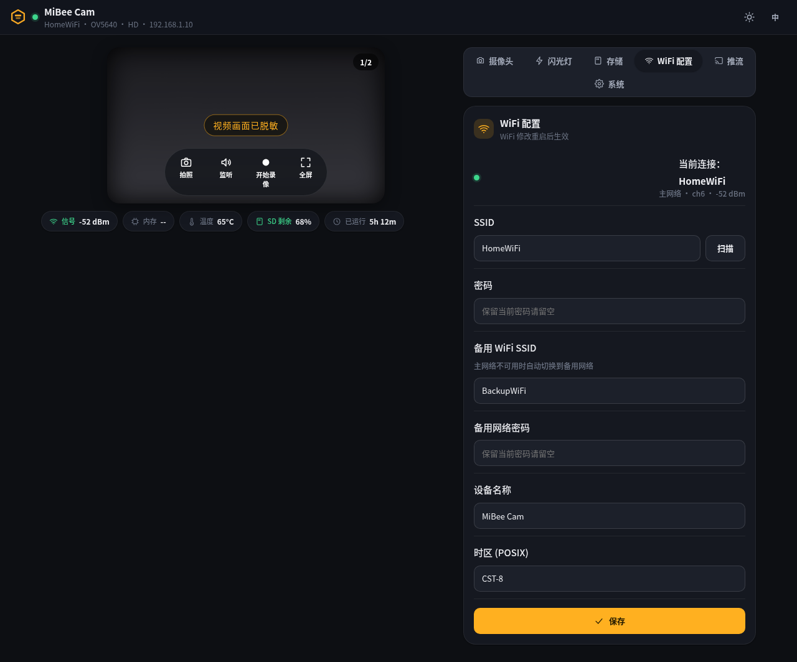
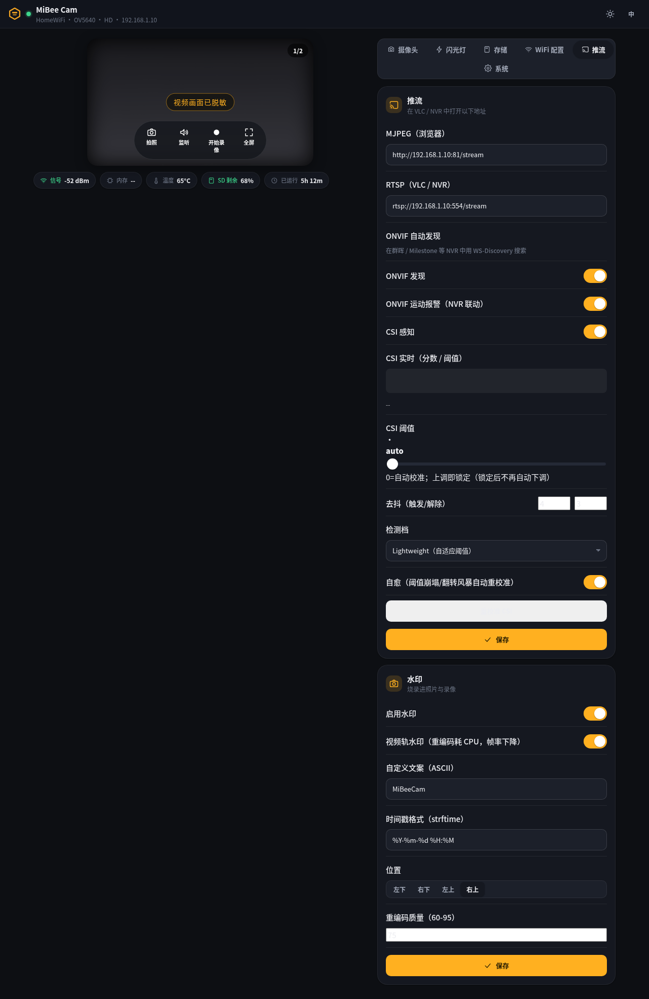
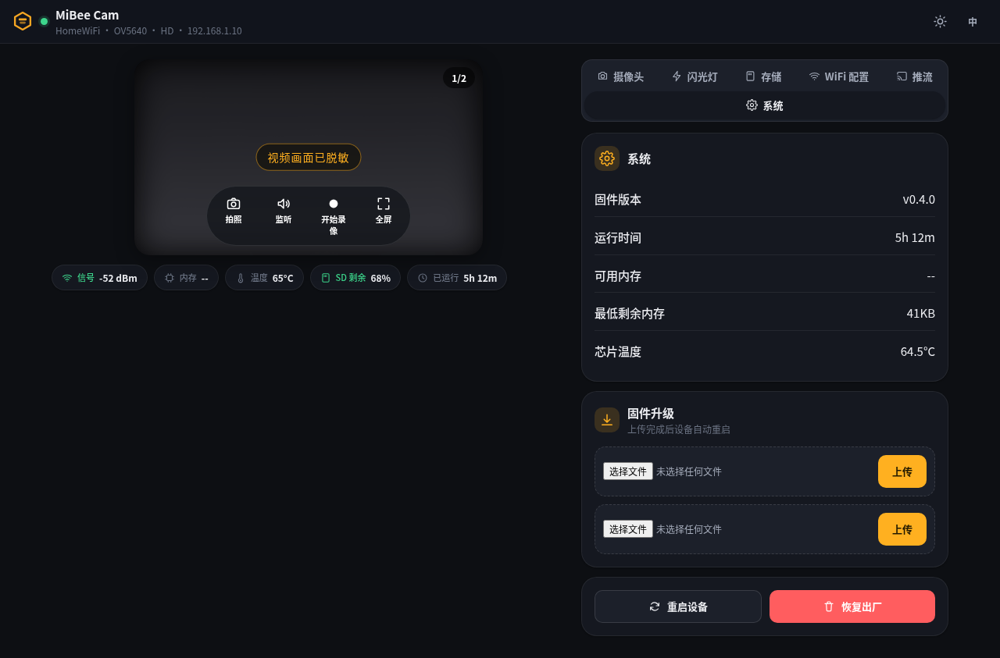

# User Guide

> Daily usage guide for ESP32-S3 Camera Monitor firmware

## Overview

This document describes the daily usage methods of ESP32-S3 Camera Monitor firmware, including Web management interface operations, configuration parameter descriptions, recording and storage management, NAS upload functions, etc.

## Web Management Interface

The device has a built-in HTTP server providing Web management interface and REST API.

### Access Address

| Mode | Address |
|------|---------|
| AP Mode | `http://192.168.4.1` |
| STA Mode | `http://<deviceIP>` |

- AP Mode: Connect to WiFi hotspot `MiBee Cam-XXXX` (password `mibeecam2026`), then access `http://192.168.4.1`
- STA Mode: After device connects to router, access via the IP assigned by router

### Login Password

None. Device-level passwords were removed family-wide (contract v1.9, 2026-09-18) — the web UI and all API endpoints are open on the trusted LAN. The security boundary is the router's WPA2 passphrase; the AP-mode hotspot password above is unchanged.

### Interface Layout

The web UI is a single-page application (SPA, "Honey" amber theme, light/dark), composed of three parts:

- **Top status bar**: device name, SSID, camera model, resolution, IP; theme and zh/en language toggles on the right (auto-follows browser language, preference kept in localStorage)
- **Video stage**: live MJPEG view + snapshot/listen/record/fullscreen controls; status chips below (signal, memory, temperature, SD headroom, uptime) pushed every second over WebSocket
- **Feature tabs**: shown/hidden by capability bits — boards without the matching hardware/feature hide the tab automatically

| Tab | Function |
|-----|----------|
| Camera | Resolution, JPEG quality, day/night mode, **IR LED GPIO / IR brightness**, mirror/flip |
| Light | LED runtime brightness (0 = off, 100 = max; manual override) |
| Storage | SD card file manager (type filter, batch select, wipe, format) |
| WiFi | Primary/backup WiFi, device name, timezone |
| Streams | MJPEG/RTSP URLs, ONVIF discovery & motion alarm, CSI tuning, watermark |
| System | Firmware info, OTA update (app + UI uploads), reboot, factory reset |

### Camera Tab



- **Resolution**: the dropdown lists only frames allowed by the three-layer cap (sensor ∩ board ∩ memory); switching saves and reboots
- **JPEG quality**: slider bounds are declared by firmware (10-63), out-of-range values are clamped
- **Day/Night**: Color / B&W / **Auto** — in auto mode the firmware samples average frame luma every 10 s (hysteresis + 2-sample confirmation); darkness switches to B&W and lights the IR illuminator, brightness returns to color and switches it off (see [Night Vision & IR Illuminator](#night-vision--ir-illuminator))
- **IR LED GPIO**: illuminator driver pin, whitelist 1-6 (XIAO silk D0-D5, options annotated with silk names to prevent mix-ups); hot-applied, no reboot needed
- **IR Brightness (auto level)**: persistent 1-100 level — every auto-mode light-on uses this level; changing it while the lamp is lit re-dims immediately
- **Mirror / Flip**: applied immediately

### Light Tab



Runtime LED control (0-100), applied as you drag. **Division of labor with the Camera tab's "IR brightness"**: this tab = a one-shot runtime override (in auto mode it survives ≤10 s before the auto engine re-asserts the configured level); the camera-tab slider = the persistent level used by auto-mode light-on. In manual modes (Color or B&W) this tab takes over completely.

### Storage Tab



SD card file manager: all/photo/recording type filters, batch select & delete, wipe-by-type, SD format (double confirm). Circular storage: old recordings are auto-cleaned below 20% free.

### WiFi Tab



Primary/backup dual WiFi (auto-switch to backup when the primary is unreachable), device name, POSIX timezone. WiFi changes take effect after a reboot; leaving a password blank keeps the current one.

### Streams Tab



- **MJPEG (browser)**: `http://<device-ip>:81/stream`, up to 2 concurrent viewers
- **RTSP (VLC/NVR)**: `rtsp://<device-ip>:554/stream`, no authentication since v1.9
- **ONVIF discovery**: WS-Discovery — Synology/Milestone NVRs can find the camera automatically
- **ONVIF motion alarm**: CSI motion events delivered via Pull-Point subscription for NVR-triggered recording
- **CSI sensing**: runtime tuning of the WiFi-CSI motion detector (threshold, debounce, profile, self-heal)
- **Watermark**: custom text + timestamp burned into photos and recordings (position/quality adjustable)

### System Tab



Firmware version, uptime, memory and temperature; **firmware update** accepts both the app image and the UI asset bundle (SPIFFS) — after OTA the device reboots and self-tests with automatic rollback; reboot and factory reset (double confirm).

## Night Vision & IR Illuminator

This board supports an external 940nm IR illuminator (GPIO-driven, factory default GPIO5 = silk D4) that together with the auto day/night mode provides zero-light night vision.

### How automatic night vision works

With `day_night_mode=2` (auto) the firmware runs a closed loop:

1. Every 10 s it samples the average luma of the live stream (1/8-scale decode, zero-copy)
2. Luma < 40 (2 consecutive confirmations) → night: picture switches to B&W, IR lamp lights at the configured level
3. Luma recovers > 160 (an elevated threshold applies while the lamp is lit, preventing the "lamp on → picture brightens → false day → lamp off" feedback oscillation) → day: lamp off, back to color

### Measured effect (same dark scene)

| IR lamp | Mean luma | Note |
|---------|-----------|------|
| Off | 17.8 (near black) | unusable in zero light |
| On (100% level) | 115.5 (**6.5×**) | B&W image, details discernible |


> Images are mosaic-redacted; only luminance information is preserved.

### Known image phenomena

- **Pink cast in color mode at night**: 940nm IR light is sensed mostly through the sensor's red channel; the auto white balance cannot converge under near-monochrome light — this is physics. Auto mode switching to B&W in the dark removes it, which is why surveillance cameras use B&W at night
- **Occasional white/black flash at lamp switching**: auto exposure (AEC) needs several frames to re-converge; the overshoot at switch instants is normal
- **Very close reflective surfaces**: if IR feedback pushes luma above 160 (e.g. lens against a white wall), the picture locks in B&W + illuminator — switch to "Color" manually to exit

### Wiring & LED selection

- Driver pin whitelist **GPIO1-6** (XIAO silk D0-D5); GPIO3 (D2) is a strapping pin — with the lamp lit, a reset only affects the JTAG source selection, not the boot mode
- Current-limiting resistors are mandatory: for two 940nm LEDs wire them **in parallel, each with its own 220Ω** (~9 mA per branch); avoid wiring multiple LEDs in series behind one resistor (under-current, won't light)
- Wavelength choice: 940nm is fully invisible but weaker on the sensor; 850nm is 3-5× stronger but shows a faint red glow

## Configuration Management

### Via Web Interface

Open the `config` page, directly modify parameters and save. Changes take effect immediately and are persisted to NVS flash.

### Via API

Use `POST /api/config` interface to modify configuration (no authentication, contract v1.9):

```bash
# Modify WiFi
curl -X POST http://192.168.4.1/api/config \
  -H 'Content-Type: application/json' \
  -d '{"wifi_ssid":"MyWiFi","wifi_pass":"mypassword"}'

# Modify video parameters
curl -X POST http://192.168.4.1/api/config \
  -H 'Content-Type: application/json' \
  -d '{"resolution":1,"fps":10,"jpeg_quality":12,"segment_sec":300}'
```

> For password fields, passing `"****"` means no modification, passing actual value updates it.

### Complete Configuration Parameter Table

#### WiFi Configuration

| Parameter | Type | Default | Description |
|-----------|------|---------|-------------|
| `wifi_ssid` | string | `""` | WiFi name, enters AP mode if empty |
| `wifi_pass` | string | `""` | WiFi password |
| `wifi_ssid_2` | string | `""` | WiFi backup SSID (AP fallback) |
| `wifi_pass_2` | string | `""` | WiFi backup password |
| `allow_ap_fallback` | bool | `true` | Allow fallback to AP mode when WiFi fails |
#### Device Configuration

| Parameter | Type | Default | Description |
| `device_name` | string | `"MiBee Cam"` | Device name |

#### Upload Method Configuration

| Key | Type | Default | Description |
|-----|------|---------|-------------|
| `webdav_enabled` | bool | `false` | Enable NAS upload |
| `webdav_url` | string | `""` | WebDAV server URL (an `https://` prefix switches to HTTP(S)) |
| `webdav_user` | string | `""` | WebDAV username |
| `webdav_pass` | string | `""` | WebDAV password (returns `****` on GET) |
| `webdav_base_path` | string | `""` | Upload base path (rejects `..`) |

#### Camera Configuration

| Key | Type | Default | Description |
|-----|------|---------|-------------|
| `cam_framesize` | uint8 | `13` (HD) | Resolution (family scale 10=VGA … 15=UXGA, ≤ three-layer cap) |
| `cam_fps` | uint8 | `12` | Frame rate 1-30 |
| `cam_quality` | uint8 | `18` | JPEG quality 10-63 (lower = sharper) |
| `vflip` | bool | `false` | Vertical flip |
| `hmirror` | bool | `false` | Horizontal mirror |
| `day_night_mode` | uint8 | `0` | 0=Color, 1=B&W, 2=Auto (luma sampling + IR lamp coupling) |
| `ir_gpio` | uint8 | `5` | IR illuminator driver pin (whitelist 1-6, hot-applied) |
| `ir_brightness` | uint8 | `100` | IR lamp level 1-100 (re-asserted by auto mode) |
#### Video Configuration

| Parameter | Type | Default | Description |
|-----------|------|---------|-------------|
| `resolution` | uint8 | `1` | Resolution: 0=VGA(640×480), 1=SVGA(800×600), 2=XGA(1024×768) |
| `fps` | uint8 | `10` | Frame rate, range 1-30 |
| `segment_sec` | uint16 | `300` | Recording segment duration (seconds) |
| `jpeg_quality` | uint8 | `12` | JPEG quality, 1-63, lower value means better quality |
#### Recording Configuration

##### Recording Modes

The device supports three recording modes controlled by `timelapse_mode`:

| Mode | Description | File Prefix | Playback |
|------|-------------|-------------|----------|
| **0 = Continuous recording** | Standard AVI segmented recording as before | `REC_` | Standard |
| **1 = Normal timelapse** | Fixed interval capture, plays at 15fps | `TLM_` | 15fps AVI |
| **2 = Dynamic timelapse** | Motion-adaptive capture, saves storage | `DYN_` | 15fps AVI |

**Normal timelapse**: Uses `timelapse_interval_sec` (1-300s) for fixed interval captures.
**Dynamic timelapse**: Automatically switches between `motion_active_interval_sec` (1-30s) when motion detected and `motion_idle_interval_sec` (5-300s) when idle.

| Parameter | Type | Default | Description |
|-----------|------|---------|-------------|
| `timelapse_mode` | uint8 | `0` | Recording mode: 0=continuous, 1=normal timelapse, 2=dynamic timelapse |
| `timelapse_interval_sec` | uint16 | `0` | Timelapse interval (0=continuous, 1-300=seconds between captures) |
| `frame_drop_enabled` | bool | `false` | Enable frame dropping under resource pressure |

##### Motion Detection Settings

Available in dynamic timelapse mode (mode 2):

| Parameter | Type | Default | Description |
|-----------|------|---------|-------------|
| `motion_sensitivity` | uint8 | `30` | Motion sensitivity 0-100 (higher=more sensitive) |
| `motion_active_interval_sec` | uint8 | `2` | Dynamic mode: capture interval when motion active (seconds) |
| `motion_idle_interval_sec` | uint16 | `60` | Dynamic mode: capture interval when idle (seconds) |
#### Storage Configuration

| Parameter | Type | Default | Description |
|-----------|------|---------|-------------|
| `cleanup_low_pct` | uint8 | `20` | Auto-cleanup when free space < this % |
| `cleanup_high_pct` | uint8 | `30` | Stop cleanup when free space > this % |

#### Alert Configuration

| Parameter | Type | Default | Description |
|-----------|------|---------|-------------|
| `alert_webhook_url` | string | `""` | Alert webhook URL for HTTP POST callbacks |
| `alert_webhook_enabled` | bool | `false` | Enable alert webhook notifications |

##### Webhook Notifications

When enabled, the device sends HTTP POST callbacks to the configured URL for these events:

- **motion_detected**: Motion detected in dynamic timelapse mode
- **recording_error**: SD card write failure or recording errors
- **system_startup**: Device boot completed

Each webhook sends JSON payload:
```json
{"event_type": "motion_detected", "message": "Motion detected at 2026-06-05 14:30:15", "timestamp": "2026-06-05T14:30:15Z"}
```
## LED Indicator

The onboard LED (GPIO21, active-low) reflects the device's current status through different blinking patterns:

| Mode | LED Behavior | Meaning |
|------|-------------|---------|
| LED_STARTING | Solid | System booting |
| LED_AP_MODE | Slow blink (1-second cycle) | AP hotspot mode, waiting for configuration |
| LED_WIFI_CONNECTING | Fast blink (200ms cycle) | Connecting to WiFi |
| LED_RUNNING | Off | Normal operation, recording |
| LED_ERROR | Double blink | Error state (SD card failure, etc.) |

**Double Blink Timing Details** (LED_ERROR):

```
ON 200ms → OFF 200ms → ON 200ms → OFF 1000ms → Loop
|← 1st blink →|← 2nd blink →|← long interval →|
```

## WiFi Configuration

### AP Mode

Device automatically enters AP mode on first boot or when WiFi is not configured:

- SSID: `MiBee Cam-XXXX` (XXXX is last 4 hex digits of MAC address)
- Password: `mibeecam2026`
- IP Address: `192.168.4.1`
- Encryption: WPA2-PSK
- Max connections: 4

### Switch to STA Mode

After configuring `wifi_ssid` and `wifi_pass`, restart the device. Device automatically connects to router. Restart required to switch modes.

### Auto Reconnect

In STA mode, after disconnection, device automatically attempts to reconnect every 60 seconds without manual intervention.

### WiFi Roaming

The device supports proactive WiFi roaming based on RSSI thresholds:

- **RSSI threshold** (`wifi_roam_rssi_threshold`): When current signal drops below this value (default: -75 dBm), the device attempts to find a better AP. Set to `0` to disable.
- **RSSI gap** (`wifi_roam_rssi_gap`): Required signal difference before switching (default: 10 dBm). Prevents rapid oscillation between equally strong APs.

Configure via Config page → WiFi section, or via API:

```json
{"wifi_roam_rssi_threshold": -70, "wifi_roam_rssi_gap": 8}
```

## Recording Management

### Auto Recording

After device boots, if SD card is ready, recording starts automatically.

### Manual Control

Manually start or stop recording via API:

```bash
# Start recording
curl -X POST "http://192.168.4.1/api/record?action=start"

# Stop recording
curl -X POST "http://192.168.4.1/api/record?action=stop"
```

### Recording Format


- **Format**: AVI (MJPEG encoding)
- **Segmentation**: Auto-segmented by `segment_sec` (default 300 seconds = 5 minutes)
- **File naming**: `REC_YYYYMMDD_HHMMSS.avi` (e.g., `REC_20260424_143000.avi`)
- **Storage path**: `/sdcard/recordings/YYYY-MM/DD/` (organized by date)
- **Timelapse Mode**: When `timelapse_interval_sec > 0`, files use `TLM_` prefix and play at 15fps

After each segment completes: NAS upload → Storage cleanup → Start next segment.

## Storage Management

### Recording Path

```
/sdcard/recordings/
├── 2026-04/
│   ├── 24/
│   │   ├── REC_20260424_080000.avi
│   │   ├── REC_20260424_080500.avi
│   │   └── ...
│   └── 25/
│       └── ...
```

### Circular Storage


Automatic cleanup when SD card free space is insufficient:

- **Below `cleanup_low_pct` (default 20%)**: Start deleting oldest recording files
- **Continue cleanup until `cleanup_high_pct` (default 30%)**: Check after each segment recording completes
- **Write failure recovery**: On write failure, recorder attempts cleanup+retry
- **Safety limit**: Max 100 files deleted per single cleanup
### Startup Cleanup

On device startup, automatically scans `/sdcard/recordings/` directory and deletes incomplete AVI files with RIFF header size of 0 (usually caused by abnormal power-off).

### SD Card Hot-plug

Device checks SD card status every 10 seconds:

| Event | Behavior |
|-------|----------|
| SD card removed | Stop current recording, LED shows error state |
| SD card inserted | Remount, automatically resume recording, LED returns to normal |

## NAS Upload

### Upload Method Configuration

Select upload method via the `upload_method` field (mutually exclusive, only one can be active):

| Value | Method | Description |
|-------|--------|-------------|
| `0` | Disabled | No upload, local SD card storage only |
| `1` | WebDAV | Upload via WebDAV protocol to NAS |
| `2` | HTTP(S) | Upload via HTTP PUT, supports HTTPS |
#### WebDAV Upload Configuration

| Parameter | Description |
|-----------|-------------|
| `webdav_url` | WebDAV server complete URL |
| `webdav_user` | WebDAV username |
| `webdav_pass` | WebDAV password |
| `webdav_enabled` | Set to `true` to enable (requires `upload_method=1`) |

#### HTTP(S) Upload Configuration

| Parameter | Description |
|-----------|-------------|
| `http_upload_url` | HTTP(S) upload full URL |
| `http_upload_user` | HTTP(S) username |
| `http_upload_pass` | HTTP(S) password |
| `http_upload_skip_cert_verify` | Skip HTTPS certificate verification (set to `true` for self-signed certs) |
| `upload_base_path` | Upload base path (default `/MiBee Cam`) |

**Mutually exclusive**: Only one upload method can be active at a time. Previous upload configurations are preserved in NVS when switching methods but will not be used.

### Upload Queue

- Queue capacity: 16 files
- Max 3 retries per file
- After 10 consecutive failures, pause upload for 5 minutes
- Background task processes asynchronously without affecting recording

### View Upload Status

```bash
curl http://192.168.4.1/api/status
```

Returns `upload_queue` (pending upload count) and `last_upload` (last upload time).

## TF Card Configuration Override

On startup, device reads configuration files on SD card, which have higher priority than configurations saved in NVS.

### wifi.txt

Path: `/sdcard/config/wifi.txt`

```
SSID=YourWiFiName
PASS=YourWiFiPassword
```

### nas.txt

Path: `/sdcard/config/nas.txt`

UPLOAD_METHOD=webdav
WEBDAV_URL=https://dav.example.com/path
WEBDAV_USER=user
WEBDAV_PASS=pass
WEBDAV_ENABLED=false
HTTP_UPLOAD_URL=
HTTP_UPLOAD_USER=
HTTP_UPLOAD_PASS=
HTTP_UPLOAD_SKIP_CERT=true
UPLOAD_BASE_PATH=/MiBee Cam
```

Lines starting with `#` are ignored.

### Configuration Priority

```
TF Card Config Files > NVS Flash > Default Values
```

Configurations read from TF card are synchronized back to NVS to ensure consistency.

Configurations read from TF card are synchronized back to NVS to ensure consistency.

## OTA Firmware Update

The device supports three OTA update modes via the web UI (`/ota.html`):

1. **URL trigger** — Enter a firmware download URL, device fetches and flashes
2. **Binary upload** — Upload a `.bin` firmware file directly via web browser
3. **SPIFFS upload** — Upload a `spiffs.bin` image to update web UI pages

All updates are SHA-256 verified. After update, the device reboots and runs a self-test (camera initialization check). If the self-test fails, the firmware automatically rolls back to the previous version.

**API trigger** (URL mode only):

```bash
curl -X POST http://192.168.4.1/api/ota \
  -H "Content-Type: application/json" \
  -d '{"url":"https://example.com/firmware/mibee_cam.bin"}'
```

Current firmware version: v0.4.0
## Video Stream

### Browser Viewing

Open directly in browser:

```
```
http://<deviceIP>:81/stream
```
```

### Client Limit


### ONVIF Discovery

The camera supports ONVIF WS-Discovery protocol and can be auto-discovered by NVR systems (Network Video Recorders). The device announces itself on the network using standard ONVIF discovery messages, making it compatible with most professional surveillance systems.

For detailed ONVIF configuration and integration, refer to the ONVIF documentation and your NVR system's manual.
Supports maximum **2** simultaneously connected streaming clients. Returns 503 error when limit exceeded.

### Adjust Quality

Modify video parameters via `POST /api/config`:

| Parameter | Values | Description |
|-----------|--------|-------------|
| `resolution` | 0, 1, 2 | VGA(640×480), SVGA(800×600), XGA(1024×768) |
| `fps` | 1-30 | Frame rate, higher is smoother but uses more bandwidth |
| `jpeg_quality` | 1-63 | Quality, lower value means better quality (recommended 10-20) |

### Camera Flip Settings

Modify camera flip/mirror via `POST /api/config`:

```bash
curl -X POST http://192.168.4.1/api/config \
  -H 'Content-Type: application/json' \
  -d '{"vflip":true,"hmirror":true}'
```

| Parameter | Description |
|-----------|-------------|
| `vflip` | Vertical flip (upside down) |
| `hmirror` | Horizontal mirror (left-right flip) |

> ⚠️ Flip settings take effect immediately on **newly captured frames**. Already recorded AVI files are not affected. It is recommended to modify flip settings while recording is stopped.
## Time Management

### Auto Sync

In STA mode, device automatically syncs time via NTP after startup:

- Servers: `cn.pool.ntp.org`, `ntp.aliyun.com`
- Sync timeout: 5 seconds (continues asynchronously after timeout)

### Manual Setting

```bash
curl -X POST http://192.168.4.1/api/time \
  -H "Content-Type: application/json" \
  -d '{"year":2026,"month":4,"day":24,"hour":14,"min":30,"sec":0}'
```

## Factory Reset

### Method 1: BOOT Button

Hold BOOT button (GPIO0) for **5 seconds**, device automatically restores factory settings and restarts.

### Method 2: Web Interface

Click "Factory Reset" button on Web configuration page.

### Method 3: API

```bash
curl -X POST http://192.168.4.1/api/reset
```

### Reset Result

All configuration parameters restored to default values (WiFi cleared; no web password exists since contract v1.9), device enters AP mode after restart. Recording files on TF card are not deleted.

---

## Feature Mutual Exclusion & Resource Limits

### ⚠️ Upload Method Mutual Exclusion
Upload method (`upload_method`) can only be one of: Disabled, WebDAV, or HTTP(S). When switching methods, previous upload configurations are preserved in NVS but will not be used.

### ⚠️ Video Stream Concurrency Limits
The system has 2 video stream consumers sharing the camera frame buffer:
1. **Recording task** (recording_task) — Core 0, highest priority
2. **MJPEG HTTP stream** (/stream) — Max 2 clients

The camera frame buffer pool size is 2 (double buffer). When both consumers are active simultaneously, frame contention may occur. Recommendations:
- Normal use: Recording + 1 HTTP stream client
- Recording task has highest priority and will not drop frames due to stream clients
### ⚠️ Flip Settings Don't Affect Recorded Videos
### ⚠️ Flip Settings Don't Affect Recorded Videos
vflip/hmirror settings take effect immediately on **newly captured frames**, but:
- Already recorded AVI files are not affected
- Flip can be toggled during recording, but frames within the same segment may have inconsistent orientation
- It is recommended to modify flip settings after stopping recording

### ⚠️ Upgrading from Older Versions
When upgrading from an older version (with FTP support), the device automatically migrates NVS configuration:
- Old `ftp_enabled=true` → `upload_method=1` (WebDAV)
- Old `webdav_enabled=true` → `upload_method=1` (WebDAV)
- Old FTP-related NVS keys are automatically deleted

## Prometheus Monitoring

The device provides a `/metrics` endpoint with 15 system metrics in text exposition format for external monitoring systems.

### Access Metrics

```bash
curl http://192.168.4.1/metrics
```

### Available Metrics

- `system_uptime_seconds`: Device uptime
- `recording_status`: Current recording state (0=stopped, 1=recording)
- `wifi_strength_dbm`: WiFi signal strength
- `sdcard_used_bytes`: SD card used space
- `sdcard_free_bytes`: SD card free space
- `chip_temp_celsius`: ESP32-S3 chip temperature
- `upload_queue_size`: Files pending upload
- `total_recorded_files`: Total recording files
- `fps_current`: Current frames per second
- `memory_free_bytes`: Free heap memory
- `memory_psram_free_bytes`: Free PSRAM memory
- `heap_watermark_bytes`: Heap watermark (lowest free)
- `stack_watermark_bytes`: Stack watermark (lowest free)
- `http_clients`: Current HTTP stream client count
- `http_clients`: Current HTTP stream client count

### Temperature Monitoring

ESP32-S3 chip temperature is available via `/api/status` with color-coded dashboard indicators:
- **< 40°C**: Green (normal)
- **40-60°C**: Yellow (warm)
- **> 60°C**: Red (hot)
